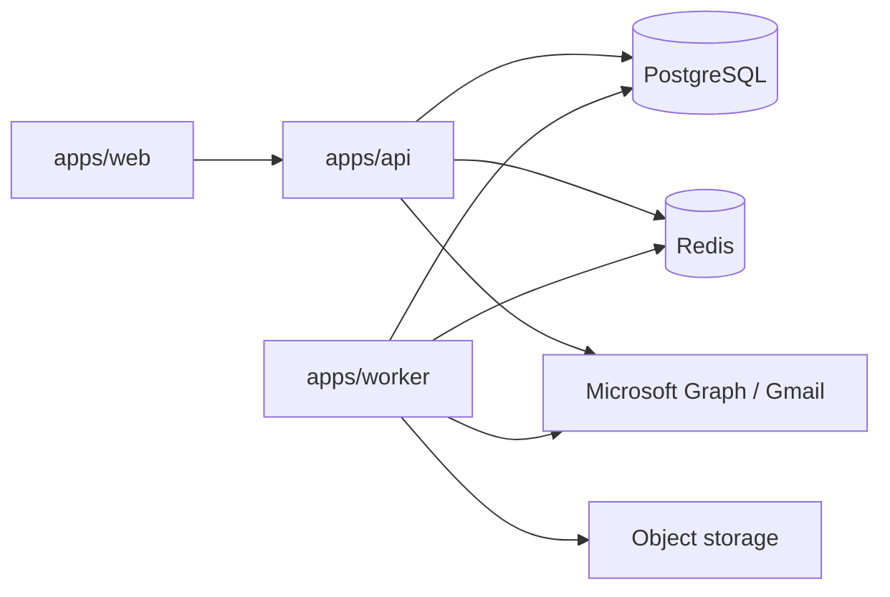

# ForgeOps

ForgeOps is a private-access, multi-tenant operations platform for construction email, Jobs, Active Bids, tasks, and related project records.

It connects mailboxes (Outlook is the primary live provider; Gmail is also implemented), ingests canonical `EmailMessage` rows, classifies mail, matches mail to Jobs with a **deterministic** matcher, and surfaces Inbox / Jobs / Active Bids / Tasks in a web app.

ForgeOps is the system of record. Gmail and Microsoft Graph are upstream providers, not the application database.

## Status of this README

This file is the onboarding entry point. Detailed architecture lives in [`docs/`](docs/README.md).

**Do not treat older docs, comments, or planned features as current behavior.** The Prisma schema, API, worker, and UI are authoritative.

## High-level architecture

```text
apps/web     React + Vite SPA          → Vercel (forgeops-inbox.com)
apps/api     Fastify HTTP API          → Railway
apps/worker  BullMQ consumers          → Railway
packages/db  Prisma + PostgreSQL
packages/shared  Contracts, matcher, gates
packages/ai / native-classification    LLM helpers (classification / bidding extraction)
```



| Service | Responsibility |
|---------|----------------|
| `apps/web` | UI only. Does not call Gmail/Graph or invent tenant state. |
| `apps/api` | Auth, workspace APIs, OAuth start/callback, enqueue jobs, read models. |
| `apps/worker` | Mailbox sync, historical import, native classify, attachment ingest, bid-folder analyze. |
| PostgreSQL | Canonical domain data. Owned by Prisma in `packages/db`. |
| Redis | Sessions, OAuth state, BullMQ. |
| S3-compatible storage | Email attachments, Job files, knowledge docs. |

## Repository structure

```text
apps/api          Fastify API
apps/worker       BullMQ workers
apps/web          Vite + React UI
packages/db       Prisma schema, migrations, client
packages/shared   Shared types, matcher, queues, env guards
packages/ai       OpenAI client boundary
packages/native-classification  Native classify pipeline helpers
docs/             Canonical documentation (start at docs/README.md)
```

## Local setup

1. Copy `.env.example` → `.env` at the repo root. Keep `APP_ENV=development`.
2. Never put a production `DATABASE_URL` in local `.env` or Cursor.
3. Start Postgres + Redis:

   ```bash
   docker compose up -d
   ```

   This creates `forgeops_dev` on `localhost:5432` and Redis on `localhost:6379`.

4. Install and generate Prisma:

   ```bash
   npm install
   npm run db:generate
   npm run db:migrate
   ```

5. Run API, worker, and web in three terminals:

   ```bash
   npm run dev:api
   npm run dev:worker
   npm run dev:web
   ```

| Process | Default |
|---------|---------|
| API | http://localhost:3000 |
| Web | http://localhost:5173 (proxies `/api` → API) |
| Worker | local BullMQ consumer |

Details: [`docs/operations/local-development.md`](docs/operations/local-development.md), [`docs/DEPLOYMENT.md`](docs/DEPLOYMENT.md).

## Required local services

- PostgreSQL 16 (`forgeops_dev` via docker-compose)
- Redis 7
- Optional: OpenAI key (native classify / bidding extraction)
- Optional: Google and/or Microsoft OAuth client credentials with **localhost** redirect URIs
- Optional: a **development** S3 bucket (do not use the production bucket)

## Development commands

| Command | Purpose |
|---------|---------|
| `npm run dev:api` | API with reload |
| `npm run dev:worker` | Worker with reload |
| `npm run dev:web` | Vite UI |
| `npm run build` | TypeScript project-references build |
| `npm run typecheck` | `tsc -b tsconfig.projects.json --pretty` |
| `npm run db:generate` | Prisma client |
| `npm run db:migrate` | `prisma migrate dev` (local only) |
| `npm run db:migrate:deploy` | Guarded `prisma migrate deploy` |
| `npm run db:reset:dev` | Guarded local reset |
| `npm run db:studio` | Prisma Studio |
| `npm test --workspace @forgeops/shared` | Shared tests |
| `npm test --workspace @forgeops/api` | API tests |
| `npm test --workspace @forgeops/worker` | Worker tests |
| `npm test --workspace @forgeops/web` | Web tests |
| `npm test --workspace @forgeops/ai` | AI package tests |
| `npm test --workspace @forgeops/native-classification` | Native classify tests |

There is no root `test` script. Workspace `test` scripts run Vitest.

## Environment safety

**Implementation complete ≠ production deployed.**

| | Development | Production |
|---|---|---|
| `APP_ENV` | `development` | `production` |
| Postgres | docker `forgeops_dev` | Railway Postgres |
| Redis | localhost:6379 | Railway Redis |
| Object storage | unset or a **dev** bucket | production bucket |
| OAuth rows / Graph cursors | local DB | production DB |

- Cursor/local must never use production `DATABASE_URL`.
- Never `prisma migrate reset`, `prisma migrate dev`, or `prisma db push` against production.
- Production migrations: `npm run db:migrate:deploy` only, and only when explicitly requested.
- API/worker boot calls `assertEnvSafety` and refuse mismatched localhost/remote URLs unless an explicit escape hatch is set.

Canonical rules: [`docs/DEPLOYMENT.md`](docs/DEPLOYMENT.md).

## Testing

Most tests are unit/integration with mocks and do not need production data. See [`docs/operations/local-development.md`](docs/operations/local-development.md#testing).

Job matcher tests live in `packages/shared/src/__tests__/`. Historical production evaluation is a **read-only operator CLI**, not a unit test — see [`docs/operations/matcher-evaluation.md`](docs/operations/matcher-evaluation.md).

## Migration rules

| Environment | Command |
|-------------|---------|
| Local | `npm run db:migrate` |
| Production | `npm run db:migrate:deploy` |
| Local wipe | `npm run db:reset:dev` (fail-closed; local `APP_ENV=development` only) |

Canonical: [`docs/DEPLOYMENT.md`](docs/DEPLOYMENT.md#database-migrations) and [`docs/operations/database-migrations.md`](docs/operations/database-migrations.md).

## Current product (implemented)

| Area | Status |
|------|--------|
| Outlook mailbox sync, Sent Items (`listenSent`), historical import | Implemented |
| Gmail mailbox sync | Implemented |
| Native OpenAI classification (BUSINESS/PERSONAL + subtypes) | Implemented |
| Deterministic Job matcher (Markers 1–3) | Implemented; **auto-assign OFF** |
| Active Bids (`BidCandidate`) | Implemented (permanent operational entity) |
| ForgeOps compose/send + Sent reconciliation | Implemented |
| Tasks + calendar (assignee-owned due dates) | Implemented |
| Direct Active Bid document upload | **Not implemented** |
| Automatic Email → Job assignment | **Off** (`JOB_MATCHER_AUTO_ASSIGN_ENABLED` default false) |
| n8n ingest | Optional alternate path; not the local default |

## Deeper documentation

Start at **[`docs/README.md`](docs/README.md)** for the documentation map.

Important canonical docs:

- [Architecture overview](docs/architecture/overview.md)
- [Email ingestion](docs/architecture/email-ingestion.md)
- [Job matching](docs/architecture/job-matching.md)
- [Active Bids](docs/architecture/bidding-active-bids.md)
- [Clear / delete safety](docs/operations/email-clearing.md)
- [Matcher evaluation](docs/operations/matcher-evaluation.md)
- [Deployment & isolation](docs/DEPLOYMENT.md)
