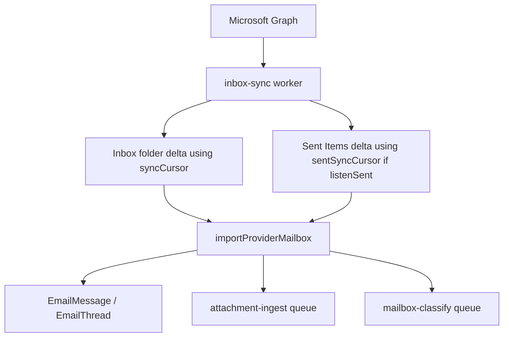

# Email ingestion

Canonical document for mailbox sync, canonical `EmailMessage`, attachments, Sent Items, and ForgeOps compose.

Related: [classification](email-classification.md), [clear/delete](../operations/email-clearing.md), [storage](storage.md).

## Source of truth

ForgeOps stores a **canonical `EmailMessage`** per imported provider message, scoped by `workspaceId` + `inboxConnectionId`.

Providers are upstream. Clearing ForgeOps records does not delete the Outlook/Gmail mailbox (see [email-clearing.md](../operations/email-clearing.md)).

## Providers

| Provider | Live inbox sync | Sent Items independent cursor | Historical import |
|----------|-----------------|-------------------------------|-------------------|
| Outlook / Microsoft Graph | **IMPLEMENTED** | **IMPLEMENTED** (`sentSyncCursor`) when `listenSent` | **IMPLEMENTED** |
| Gmail | **IMPLEMENTED** | **NOT** the Outlook `sentSyncCursor` path | **IMPLEMENTED** |

`InboxConnection.provider` is `GMAIL` \| `OUTLOOK`.

## Connection toggles

On `InboxConnection` (schema comments match the live fields):

| Field | Default | Meaning |
|-------|---------|---------|
| `ingestionSource` | `N8N` | `NATIVE` vs `N8N`. Native sync/analyze returns 409 on N8N mailboxes |
| `nativeListeningEnabled` | `false` | Explicit native listener; OAuth must not flip this on |
| `listenIncoming` | `true` | Inbox folder |
| `listenSent` | `false` | Outlook Sent Items live + historical sent phase |
| `excludeJunk` / `excludeTrash` | `true` | Skip those folders |
| `deleteFromProviderOnDelete` | `false` | Inbox **UI trash only**. Bulk clear ignores this |
| `syncCursor` | | Outlook Inbox Graph deltaLink (or Gmail history cursor) |
| `sentSyncCursor` | | Outlook Sent Items deltaLink — **independent** of `syncCursor` |
| `inboxClearedAt` | | Watermark: live import must not re-create provider messages at/before this instant |

Delegated / shared mailbox: `delegatedMailboxAccess` means tokens belong to `oauthAccountEmail` while Graph I/O targets `email`.

## Sync flow (Outlook)

Live processor: `apps/worker/src/application/processors/inbox-sync.processor.ts`.

1. Inbox delta using `syncCursor`.
2. If `listenSent === true` and provider is Outlook, Sent Items delta using `sentSyncCursor`.
3. `importProviderMailbox` upserts threads/messages, stamps `direction` (`RECEIVED` \| `SENT`) when known.
4. Enqueue attachment ingest and native classify.

Dedup: `@@unique([inboxConnectionId, gmailMessageId])`. Despite the Gmail-prefixed column name, this stores the **provider message id** for every provider. Application code also maintains `providerMessageId` / `providerThreadId`. `providerThreadId` is **not globally unique** — always pair with `inboxConnectionId`.

Historical import (`mailbox-historical-import`) pages Inbox first, then Sent Items when `listenSent` (Outlook), using `resumeCursor` / `sentResumeCursor`. Historical import may **bypass** `inboxClearedAt` (intentional replay). Project-folder and Bid Invites/Quotes scans also import canonical `EmailMessage` rows (lossless — association is not required for the row to exist).

## Project folders and bidding folders

Outlook `Projects/`:

| Folder | Worker queue | Effect |
|--------|--------------|--------|
| Named project folders | `project-folder-email-analyze` | Canonical import + **VERIFIED_PROJECT_FOLDER** Job assignment when verified |
| `Bid Invites/` | `bid-email-analyze` | Canonical import + `BID_OPPORTUNITY` subtype + Candidate discovery |
| `Quotes/` | `bid-email-analyze` | Canonical import + `ESTIMATE_QUOTE` subtype + quote staging |

Unmatched Bid Invite / Quote emails **still survive** as `EmailMessage`. Scan is discovery; grouping is a separate analyze operation. Details: [bidding-active-bids.md](bidding-active-bids.md).

## Attachments

- Metadata on `EmailMessage`; bytes on `EmailAttachment` (`storageKey` in object storage).
- Worker queue `attachment-ingest` downloads from Graph/Gmail and uploads to S3.
- Text extraction for PDFs/DOCX is stored on `EmailAttachment.extractedText` (not OCR).
- Inline images can later receive relevance classification (vision gated off by default).

## ForgeOps compose and Sent reconciliation

**IMPLEMENTED.**

Graph `sendMail` returns 202 without a provider message id. ForgeOps persists a local `EmailMessage` with:

- `composedInForgeOps = true`
- a local id prefix `forgeops-sent-`
- user-explicit subtype (compose defaults Email Type to `GENERAL`)

When Sent Items sync later sees the provider copy, reconciliation **enriches the local row**. It does **not** merge on subject alone.

Match requires all of (`packages/shared/src/outbound-send-reconcile.ts`):

1. Normalized subject (strips `re:` / `fw:` / `fwd:`)
2. Exact primary **To** set (sorted, lowercased)
3. `|sentAt|` within **120 seconds**

Cc/Bcc are not the match key. Window constant: `FORGEOPS_SENT_RECONCILE_WINDOW_MS = 120_000`.

## Alternate path: n8n

Optional. `InboxConnection.ingestionSource = N8N`. Contract: [`../n8n-integration.md`](../n8n-integration.md). Native Graph is the recommended local intake.

## Related code

- `apps/worker/src/application/services/import-provider-mailbox.ts`
- `apps/worker/src/infrastructure/providers/outlook/`
- `apps/worker/src/infrastructure/providers/gmail/`
- `packages/shared/src/inbox-cleared-at.ts`
