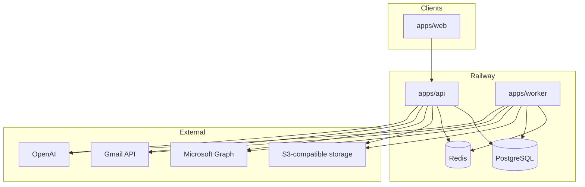

# Architecture overview

**Status:** IMPLEMENTED as described below. This is the current system, not the original Gmail-only scaffold.

## Applications

| App | Package | Process | Production |
|-----|---------|---------|------------|
| API | `@forgeops/api` | `node apps/api/dist/main.js` | Railway, `api.forgeops-inbox.com` |
| Worker | `@forgeops/worker` | `node apps/worker/dist/main.js` | Railway (no public HTTP) |
| Web | `@forgeops/web` | static `apps/web/dist` | Vercel, `forgeops-inbox.com` |

There is no in-repo `railway.json`. Railway/Vercel wiring is dashboard configuration. Vercel rewrites `/api/*` to the production API (`apps/web/vercel.json`).

## Shared packages

| Package | Role |
|---------|------|
| `@forgeops/db` | Prisma schema, migrations, client |
| `@forgeops/shared` | Queue names, provider types, matcher, env guards, classification authority |
| `@forgeops/ai` | OpenAI client; live extractors + a **placeholder** `OpenAIInboxClassifier` |
| `@forgeops/native-classification` | Native classify pipeline helpers |

## Boundaries

- **Web** renders backend state. It must not call Gmail/Graph, store OAuth tokens, or invent workspace access.
- **API** is the HTTP contract: auth, CRUD, enqueue, reads.
- **Worker** owns long-running mailbox/analyze/ingest jobs.
- **Postgres** is the system of record. Workspace is the tenant boundary (`workspaceId` on operational rows).
- **Redis** is sessions, OAuth state TTL, and BullMQ. Local and production **must not share** a Redis instance (queue names are the same).

## Database ownership

Canonical schema: `packages/db/prisma/schema.prisma`.

Major operational aggregates (not an exhaustive field list):

- **Workspace** — tenant
- **User** + **Membership** + **ApprovedAccess** — identity and allowlist
- **InboxConnection** — one connected mailbox (Gmail or Outlook)
- **EmailThread** / **EmailMessage** / **EmailAttachment** / **NormalizedEmail** / **Classification**
- **Job** + **EntityAlias** + **EntityContact** + **JobEmailContact** + **JobParticipant**
- **BidCandidate** + **BidCandidateEmail** + **BidQuoteStaging**
- **Task** / **CalendarEvent**
- **Customer** / **Vendor**
- Job operational children (documents, RFIs, POs, etc.)
- **AuditEvent**

`EmailMessage.jobId` is canonical Job assignment for Inbox. `Classification.jobId` is a separate column (see [job-matching.md](job-matching.md)).

Cascade notes that matter operationally:

- Deleting `EmailMessage` cascades attachments, `NormalizedEmail`, `BidCandidateEmail`, `BidQuoteStaging`, folder-discovery rows.
- `Classification` and `Task` FKs to the message are **SetNull** on message delete — Clear Inbox therefore deletes those rows explicitly. See [email-clearing.md](../operations/email-clearing.md).
- `BidCandidate.canonicalJobId` is **SetNull** if the Job is deleted; converting a Candidate does **not** delete the Candidate.
- `JobEmailContact.firstEmailMessageId` is **SetNull** if that email is deleted; the contact row remains.

## Queue architecture

Canonical names: `packages/shared/src/constants/queues.ts`.

| Queue | Producer | Consumer | Result |
|-------|----------|----------|--------|
| `inbox-sync` | API, webhooks, scheduled reconcile | worker | Graph/Gmail pull → `EmailMessage` |
| `mailbox-historical-import` | API mailbox-control | worker | paged historical import |
| `mailbox-classify` | sync/import/reclassify processors, API retry | worker | native classify + matcher **candidates** |
| `attachment-ingest` | sync/import/API | worker | bytes → S3 + extract |
| `project-folder-email-analyze` | API folder-discovery | worker | verified Projects folder import + Job assign |
| `bid-email-analyze` | API bid-analysis | worker | Bid Invites/Quotes scan + Candidate grouping |
| `mailbox-reclassify` | API | worker | admin reclassify run |
| `inline-image-relevance` | API / worker pagination | worker | gated vision pass |
| `inbox-analysis` | API | worker | **LEGACY** heuristic analyze (not native classify) |
| `ai-extraction` | none | **none** | named constant only; no worker |

## Provider integrations

| Provider | Status |
|----------|--------|
| Microsoft Graph (Outlook) | **IMPLEMENTED** — live inbox + Sent Items delta, historical import, project folders, Bid Invites/Quotes, compose/send |
| Gmail | **IMPLEMENTED** — OAuth + sync; Sent Items independent cursor is Outlook-specific |
| n8n POST ingest | **IMPLEMENTED** as optional `ingestionSource: N8N`; not the local default |
| Google Calendar / Microsoft Calendar sync | **NOT IMPLEMENTED** |

Split interfaces still exist (`InboxOAuthProvider` on API, `InboxSyncProvider` on worker). Outlook is no longer “planned.”

## Authentication vs mailbox identity

These are different people/systems. Canonical: [auth.md](auth.md).

| Concept | What it is |
|---------|------------|
| ForgeOps user | `User` signed in via Google or Microsoft **app** OAuth |
| Workspace membership | `Membership.role` (`OWNER` \| `ADMIN` \| `MANAGER` \| `MEMBER` \| `VIEWER`) |
| Allowlist | `ApprovedAccess` — login is denied without an ACTIVE row |
| Platform admin | `User.platformRole = PLATFORM_ADMIN` (not a workspace role) |
| Mailbox OAuth identity | `InboxConnection.oauthAccountEmail` — who granted the token |
| Target mailbox | `InboxConnection.email` — the mailbox Graph I/O targets |

## AI vs deterministic logic

| Concern | Kind |
|---------|------|
| Job matcher (Markers 1–3) | **Deterministic. Not LLM.** |
| Job auto-assign persistence | Gated **OFF** (`JOB_MATCHER_AUTO_ASSIGN_ENABLED`) |
| Native BUSINESS/PERSONAL + subtype | OpenAI (`mailbox-classify`) |
| Bid/Quote field extraction, quote match adjudicator | OpenAI (bid-email-analyze / API suggestions) |
| Task extraction from email | OpenAI, only when classify says there is an action request |
| Inline image relevance | Deterministic metadata first; vision gated **OFF** by default |
| `OpenAIInboxClassifier` | Placeholder; not the live pipeline |

Enum values `AI_AUTO_ASSIGNED` / `AI_SUGGESTED` are matcher **provenance labels**, not proof that an LLM chose the Job.

Canonical inventory of automated decision systems: [Intelligence Registry](intelligence-registry.md) (`INTELLIGENCE_CATALOG` in `@forgeops/shared`). New intelligence must register there; Manage → Intelligence discovers and renders from the typed catalog (safe DTOs).

## Responsive UI scale

**IMPLEMENTED** (not CSS `zoom`).

- CSS variable `--fo-ui-scale` on `:root`
- Laptop baseline scale `1` (starts increasing after ~1760×980)
- Cap `1.12` on large desktops
- `@media (max-width: 1200px), (max-height: 700px)` forces scale `1` (mobile/tablet preserved)
- Vite plugin rewrites authored `px` to `calc(px * var(--fo-ui-scale))`

Code: `apps/web/src/ui-scale.ts`, `apps/web/src/index.css`, `apps/web/vite-plugin-fo-ui-scale.ts`.

## Related

- [Email ingestion](email-ingestion.md)
- [Classification](email-classification.md)
- [Job matching](job-matching.md)
- [Active Bids](bidding-active-bids.md)
- [Intelligence Registry](intelligence-registry.md)
- [Deployment](../DEPLOYMENT.md)
